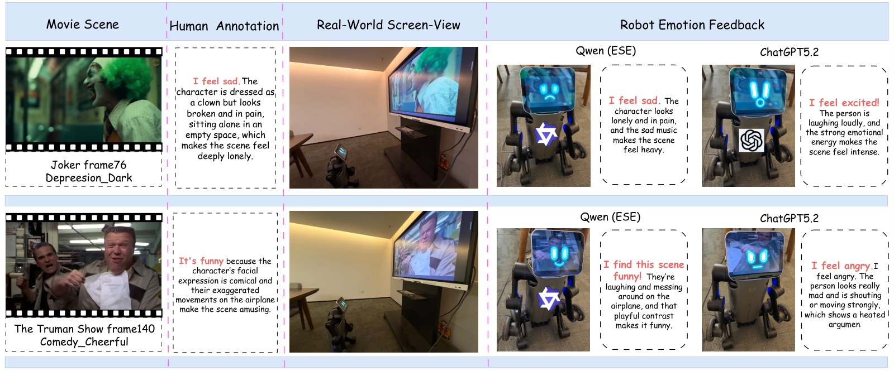

# RoboAffect

**[CoRL 2026]** Egocentric Emotion Reasoning for Robot Companions in Shared Viewing

[](#citation)
[](https://huggingface.co/datasets/DZCyber/EgoScreen-Emotion)
[](LICENSE)

**Ze Dong<sup>1\*</sup>, Hao Shi<sup>2,4,\*</sup>, Zejia Gao<sup>3</sup>, Zhonghua Yi<sup>4</sup>, Kaiwei Wang<sup>4</sup>, Lin Wang<sup>1†</sup>**

<sup>1</sup>EmPACT Lab, School of EEE, Nanyang Technological University ·
<sup>2</sup>Ant Group ·
<sup>3</sup>Okayama University of Science ·
<sup>4</sup>Zhejiang University

<sup>\*</sup>Equal contribution · <sup>†</sup>Corresponding author

> Watching movies together with humans provides a natural setting for robot affective perception. **RoboAffect** introduces **EgoScreen-Emotion (ESE)**—the first benchmark for **viewer-level** emotion under egocentric screen-view conditions—plus a multimodal reference framework and real-robot demonstration.

<p align="center">
  
  <br/>
  <em>(A) Shared viewing under robot-relevant conditions · (B) Egocentric multimodal inputs · (C) ESE-supervised affect inference · (D) LED + spoken rationale response.</em>
</p>

---

## Highlights

| | |
|---|---|
| **Dataset (ESE)** | 224 trailers · **28,667** egocentric keyframes · **18** viewing conditions · **5** raters with multi-label confidence |
| **Domain gap** | Raw→Ego Macro-F1 drops **28.06 → 14.64** (**47.8%** relative decline) |
| **Model** | Qwen2.5-Omni-7B + LoRA · 3 frames + 10s audio + narrative summaries |
| **Result** | Macro-F1 **32.74** = **85.1%** of human LOO reference (**38.49**) · > Gemini-2.5-Flash (**23.50**) |
| **Robot** | Quadruped demo + user study: higher exclusive preference vs.\ Gemini on perception & response |

---

## Inter-annotator agreement

<p align="center">
  
  
  <br/>
  <em>Left: Fleiss' κ vs.\ confidence threshold (overall κ=0.34; κ=0.72 at high confidence). Right: per-category κ and Spearman ρ.</em>
</p>

## Dataset statistics

<p align="center">
  
  
  
  <br/>
  <em>(a) Emotion × genre · (b) Per-annotator selection patterns · (c) Overall long-tailed viewer-level distribution.</em>
</p>

---

## Method

<p align="center">
  
  <br/>
  <em>Multimodal triplet (V<sub>t</sub>, A<sub>t</sub>, S<sub>t</sub>) → emotion + rationale; LED expression + TTS affective action.</em>
</p>

---

## Results

### Cross-domain gap (Raw vs.\ Ego)

| Setting | Acc | Macro-F1 | Weighted-F1 |
|---|---:|---:|---:|
| Raw→Raw | 63.72 | 28.06 | 62.15 |
| Ego→Ego | 56.33 | 24.81 | 57.09 |
| **Raw→Ego** | 61.05 | **14.64** | 52.55 |
| Ego→Raw | 60.04 | 27.55 | 60.72 |

### Main comparison & modality ablation (ESE test)

| Type | Model / Setting | Acc | Macro-F1 | Weighted-F1 |
|---|---|---:|---:|---:|
| Zero-shot | Qwen2.5-Omni-7B | 55.22 | 16.36 | 46.76 |
| Zero-shot | Qwen3-VL-8B | 52.37 | 15.83 | 46.78 |
| Zero-shot | LLaVA-1.6-13B | 52.55 | 8.75 | 40.38 |
| Zero-shot | LLaVA-OneVision-1.5-8B | 39.18 | 14.08 | 37.23 |
| Zero-shot | InternVL2-8B | 41.21 | 16.61 | 44.01 |
| Zero-shot | Qwen3.5-Plus | 54.07 | 16.88 | 49.58 |
| Zero-shot | GPT-5.2 | 56.87 | 18.36 | 52.85 |
| Zero-shot | Gemini-2.5-Flash | 52.62 | **23.50** | 53.52 |
| Human | LOO reference | 61.12 | **38.49** | 62.73 |
| Fine-tuned | InternVL2-8B + LoRA | 56.18 | 22.10 | 55.64 |
| Fine-tuned | Qwen3-VL-8B + LoRA | 61.18 | 22.13 | 58.28 |
| Fine-tuned | ESE: 1F | 56.33 | 24.81 | 57.09 |
| Fine-tuned | ESE: 1F + Rationale | 56.19 | 25.70 | 56.53 |
| Fine-tuned | ESE: 3F | 58.33 | 26.76 | 58.63 |
| Fine-tuned | ESE: 3F + Audio | **63.14** | 29.26 | **63.23** |
| Fine-tuned | **ESE: 3F + Audio + Narr** | 61.52 | **32.74** | 62.96 |

### Robot demonstration & user study

<p align="center">
  
  <br/>
  <em>Movie scene · human viewer annotation · egocentric observation · Ours vs.\ GPT-5.2 under real screen-view conditions.</em>
</p>

User study vs.\ Gemini-2.5-Flash (N=30, 25 clips each):

| Measure | Ours | Gemini | Both | Neither | p |
|---|---:|---:|---:|---:|---:|
| Perception pref. (%) | **35.5** | 16.5 | 22.9 | 25.1 | &lt;.001 |
| Response pref. (%) | **32.5** | 19.5 | 25.5 | 22.5 | .012 |
| Godspeed PI | **4.05±0.38** | 3.25±0.40 | — | — | &lt;.001 |
| RoSAS Competence | **7.50±0.85** | 6.23±1.23 | — | — | &lt;.001 |

---

## Download

| Asset | Location |
|---|---|
| Annotations, narrative JSON, metadata | **This repo** |
| Ego frames / audio (large) | See layout below / local packaging |
| Ego videos (mp4) | [Hugging Face](https://huggingface.co/datasets/DZCyber/EgoScreen-Emotion) |

```bash
git clone https://github.com/DZCyber/RoboAffect.git
```

---

## Repository layout

```text
├── assets/                          # main-paper figures for this README
├── ego/
│   ├── video/{genre}/{condition}/{trailer_id}.mp4   # HF only (gitignored)
│   ├── frames/{genre}/{condition}/{trailer_id}/
│   ├── audio/{genre}/{condition}/{trailer_id}.wav
│   └── narrative/{trailer_id}.json
├── raw/
│   ├── frames/{genre}/{trailer_id}/
│   ├── audio/{genre}/{trailer_id}.wav
│   └── narrative/{trailer_id}.json
├── annotations/
│   ├── confidence/{genre}/{trailer_id}/{A..E}.json
│   └── reasoning/{genre}/{trailer_id}/{A..E}.json
└── metadata/
    └── trailers.csv
```

### Naming

| Field | Rule | Example |
|---|---|---|
| `genre` | one of 8 emotion genres | `Action_Tense` |
| `condition` | `{height}_{distance}_{angle}` | `1.3m_near_right` |
| `trailer_id` | `{id}_{title}_{year}` | `0001_1917_2019` |
| frames | 8-digit, 1 FPS from 0 | `00000000.jpg` |

**Genres:** `Action_Tense`, `Comedy_Cheerful`, `Depressive_Dark`, `Inspirational_Hopeful`, `Mystery_Reflective`, `Romantic_Warm`, `Thriller_Horror`, `Tragic_Sad`.

**Conditions:** `0.8m` / `1.3m` × `near` / `middle` / `far` × `left` / `center` / `right` (18 total).

### Label aggregation

Each rater assigns confidence \(s_{i,c} \in \{0,1,2,3,4,5\}\). Training hard label:

```text
S_c = sum_i s_{i,c}
L   = argmax_c S_c
```

---

## Citation

```bibtex
@inproceedings{dong2026roboaffect,
  title     = {RoboAffect: Egocentric Emotion Reasoning for Robot Companions in Shared Viewing},
  author    = {Dong, Ze and Shi, Hao and Gao, Zejia and Yi, Zhonghua and Wang, Kaiwei and Wang, Lin},
  booktitle = {Conference on Robot Learning (CoRL)},
  year      = {2026}
}
```

## Acknowledgments

Supported by the Start Up Grant at NTU (03INS002165C140) and the MOE AcRF Tier 1 (Call 2/2025) Grant (RG160/25).

## License

See [`LICENSE`](LICENSE). Academic research use; respect copyright of underlying trailers. Do not use for commercial affective products, surveillance, or emotion manipulation without informed consent.
