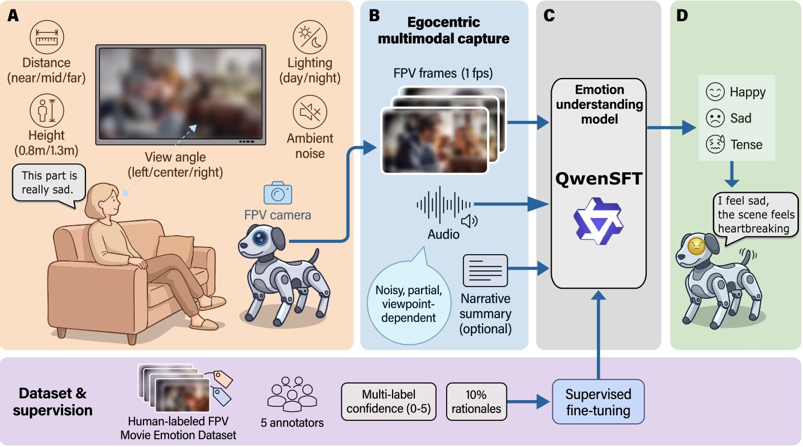
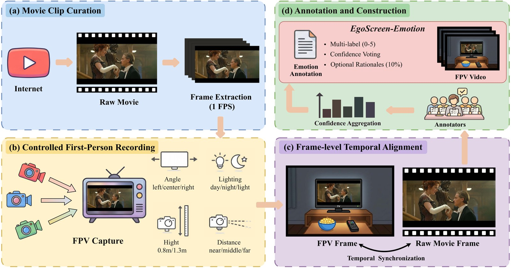
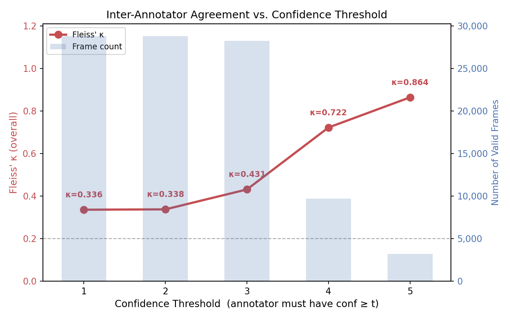
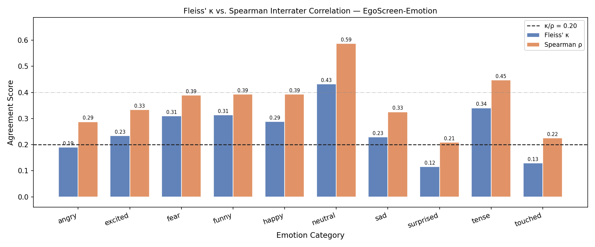
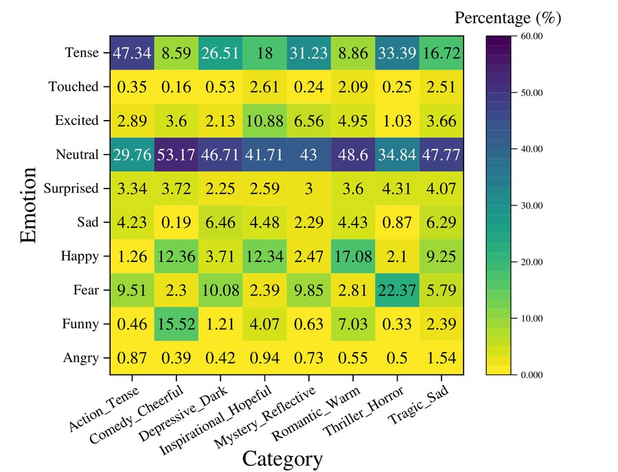
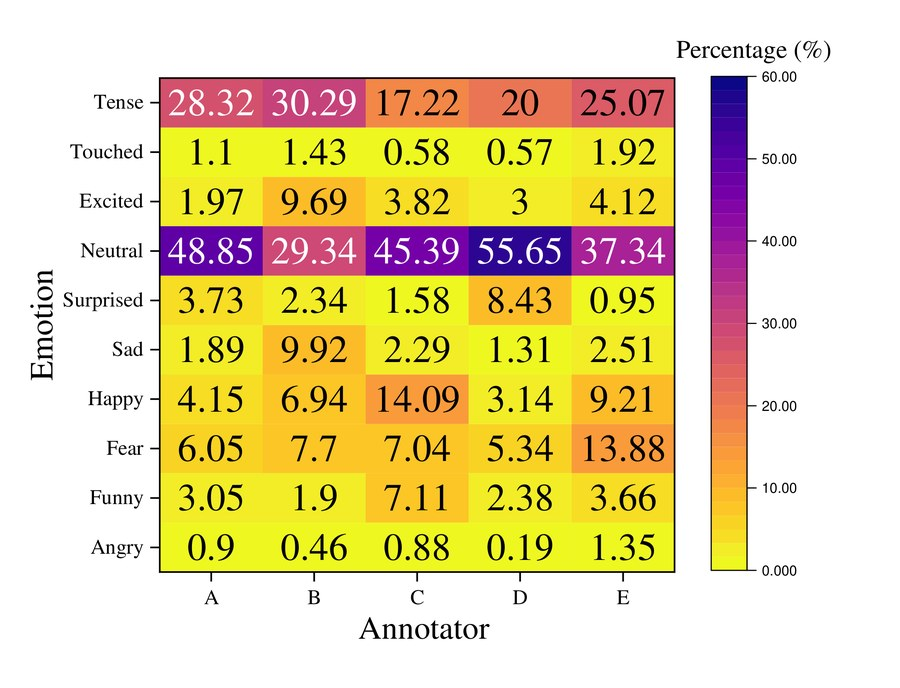
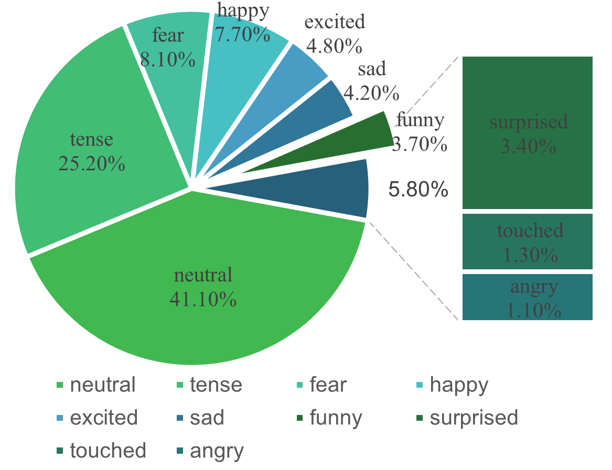
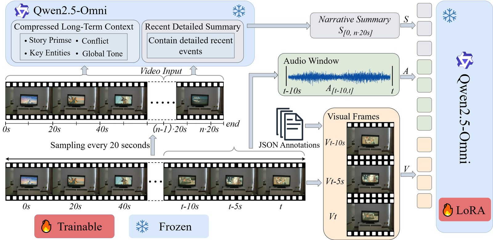
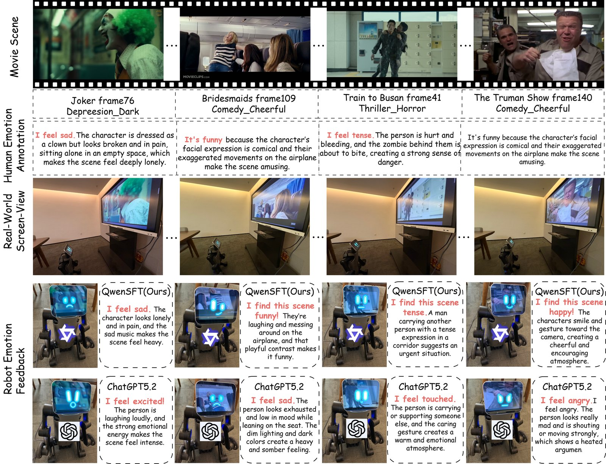

# RoboAffect

**[CoRL 2026]** Egocentric Emotion Reasoning for Robot Companions in Shared Viewing

[](#citation)
[](https://huggingface.co/datasets/DZCyber/EgoScreen-Emotion)
[](LICENSE)

> Companion robots co-watching media need **viewer-level** affective perception from egocentric screen views—not character emotion recognition. **RoboAffect** (aka EgoScreen-Emotion / ESE) provides the dataset, multimodal framework, and real-robot demonstration for this task.

<p align="center">
  
  <br/>
  <em>ESE enables robot affective perception from shared viewing: egocentric FPV capture → viewer-level emotion → emotional expression feedback.</em>
</p>

---

## Highlights

| | |
|---|---|
| **Dataset** | 224 trailers · 28,667 egocentric keyframes · **18** viewing conditions · **5** raters with confidence scores |
| **Task** | Viewer-level multi-label emotion (what the *robot as co-viewer* feels), not on-screen character affect |
| **Model** | Qwen2.5-Omni-7B + LoRA · 3 frames + 10s audio + narrative context |
| **Result** | Macro-F1 **32.74** (84.3% of human LOO ceiling **38.82**) · beats Gemini-2.5-Flash (**23.50**) |
| **Robot** | End-to-end quadruped demo: FPV perception → expression + TTS |

---

## Dataset construction

<p align="center">
  
  <br/>
  <em>(a) Trailer curation & raw frames · (b) Controlled egocentric recording (18 conditions) · (c) Temporal alignment · (d) Viewer-level confidence annotation.</em>
</p>

### Inter-annotator agreement

<p align="center">
  
  
  <br/>
  <em>Left: per-class Fleiss' κ vs. confidence threshold. Right: per-category κ and Spearman ρ.</em>
</p>

### Dataset statistics

<p align="center">
  
  
  
  <br/>
  <em>(a) Emotion × genre · (b) Per-annotator patterns · (c) Overall viewer-level distribution.</em>
</p>

---

## Method

<p align="center">
  
  <br/>
  <em>Multimodal long-context framework: short-term vision/audio + memory-inspired narrative context; label-smoothed class-balanced training.</em>
</p>

---

## Results

### Domain gap (why FPV data matters)

| Setting | Acc | Macro-F1 | Weighted-F1 |
|---|---:|---:|---:|
| Raw→Raw | 63.33 | 27.99 | 60.76 |
| FPV→FPV | 57.74 | 20.61 | 55.18 |
| **Raw→FPV** | 55.75 | **16.69** | 46.47 |
| FPV→Raw | 61.19 | 25.19 | 58.68 |

Training on pristine cinema and testing on FPV drops Macro-F1 by **~40%** (27.99 → 16.69).

### Comparison (ESE test set)

| Type | Model | Acc | Macro-F1 | Weighted-F1 |
|---|---|---:|---:|---:|
| Zero-shot | Qwen2.5-Omni-7B | 55.22 | 16.36 | 46.76 |
| Zero-shot | LLaVA-1.6-13B | 52.55 | 8.75 | 40.38 |
| Zero-shot | InternVL2-8B | 27.47 | 11.92 | 34.38 |
| Zero-shot | GPT-5.2 | 56.87 | 18.36 | 52.85 |
| Zero-shot | Gemini-2.5-Flash | 52.62 | **23.50** | 53.52 |
| Fine-tuned | **Ours (3F+Aud+Narr)** | — | **32.74** | — |
| Human LOO ceiling | — | 61.12 | **38.48–38.82** | 62.69 |

Full model reaches **84.3%** of the human leave-one-out Macro-F1 ceiling; single-frame baseline is 24.81.

### Real-robot qualitative

<p align="center">
  
  <br/>
  <em>Movie scenes → human viewer labels → FPV observations → Ours vs. GPT-5.2 zero-shot under real egocentric screen-view conditions.</em>
</p>

---

## Download

| Asset | Location |
|---|---|
| Annotations, narrative JSON, metadata | **This repo** |
| Ego frames / audio (large) | Prepared locally; see layout below |
| Ego videos (mp4) | [Hugging Face](https://huggingface.co/datasets/DZCyber/EgoScreen-Emotion) |

```bash
git clone https://github.com/DZCyber/RoboAffect.git
# Videos / heavy media: follow the Hugging Face dataset card
```

---

## Repository layout

```text
├── assets/                          # paper figures used in this README
├── ego/
│   ├── video/{genre}/{condition}/{trailer_id}.mp4   # HF only (gitignored)
│   ├── frames/{genre}/{condition}/{trailer_id}/
│   ├── audio/{genre}/{condition}/{trailer_id}.wav
│   └── narrative/{trailer_id}.json
├── raw/
│   ├── frames/{genre}/{trailer_id}/
│   ├── audio/{genre}/{trailer_id}.wav               # may be incomplete
│   └── narrative/{trailer_id}.json
├── annotations/
│   ├── confidence/{genre}/{trailer_id}/{A..E}.json
│   └── reasoning/{genre}/{trailer_id}/{A..E}.json
└── metadata/
    └── trailers.csv
```

### Naming

| Field | Rule | Example |
|---|---|---|
| `genre` | one of 8 emotion genres | `Action_Tense` |
| `condition` | `{height}_{distance}_{angle}` | `1.3m_near_right` |
| `trailer_id` | `{id}_{title}_{year}` | `0001_1917_2019` |
| frames | 8-digit, 1 FPS from 0 | `00000000.jpg` |

**Genres:** `Action_Tense`, `Comedy_Cheerful`, `Depressive_Dark`, `Inspirational_Hopeful`, `Mystery_Reflective`, `Romantic_Warm`, `Thriller_Horror`, `Tragic_Sad`.

### Label aggregation

Each rater assigns confidence \(s_{i,c} \in \{0,1,2,3,4,5\}\). Training hard label:

```text
S_c = sum_i s_{i,c}
L   = argmax_c S_c
```

### Scale (this release vs. paper)

| Item | This release | Paper |
|---|---:|---:|
| Trailers | 225 | 224 |
| Annotated frames | 28,808 | 28,667 |
| Raters | 5 (A–E) | 5 |

Paper counts match after removing `0036_Despicable_Me_2010` (included here).

---

## Citation

```bibtex
@inproceedings{roboaffect2026,
  title     = {RoboAffect: Egocentric Emotion Reasoning for Robot Companions in Shared Viewing},
  author    = {Anonymous},
  booktitle = {Conference on Robot Learning (CoRL)},
  year      = {2026}
}
```

*(Update authors / arXiv link after acceptance.)*

## License

See [`LICENSE`](LICENSE). Academic research use; respect copyright of underlying trailers. Do not use for commercial affective products, surveillance, or emotion manipulation without informed consent.
